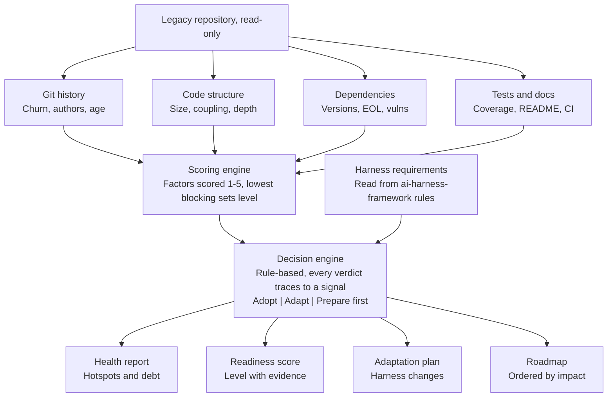

# ai-codebase-auditor — Concept & Architecture

Oct 19, 2026 · Maidelín Prieto

## Vision

The framework answers one question about any legacy codebase: is it safe and productive to let AI coding agents work in it, and if not, what has to change first? It audits the repo, scores its AI-readiness, and then decides whether your ai-harness-framework can be adopted as-is or needs adapting.

Most AI-agent tooling assumes a clean greenfield project with tests, docs and small modules. Real companies run 10-year-old systems with none of these, and that is where teams struggle to adopt agents. Your 5+ years of experience in production code, and the fact that you cannot share past private work, make this a natural portfolio piece: it shows engineering judgment, not just another AI app.

For your portfolio it adds a fourth angle next to the full-stack projects: an engineering-productivity tool that uses your own harness as the reference point and proves it works outside synthetic demos.

## Prior art and what to borrow

Readiness scoring for AI agents already exists, but none of the tools found targets legacy systems or decides how to adapt an agent harness; that is the open space for this project. Searched on 2026-10-19.

| Tool or source | What it does | Gap for this project |
| --- | --- | --- |
| [Kenogami codebase-readiness](https://github.com/Kenogami-AI/codebase-readiness) | Claude Code skill, 9 dimensions scored 1-5, remediation plan, brownfield strategy advice | Skill-based and judgment-heavy; no harness adaptation |
| [kodustech/agent-readiness](https://github.com/kodustech/agent-readiness) | MIT CLI, 39 checks in 7 pillars, maturity levels 1-5, CI gate, config file | Mostly file-presence checks; rewards modern tooling, so old but healthy code scores low |
| [AI-native readiness grid](https://framework.ai-native-transformation.com/codebase-readiness) | Levels 0-5, blocking vs. constraining dimensions, lowest score sets the ceiling | A framework, not a tool |
| [CodeScene benchmark](https://codescene.com/blog/making-legacy-code-ai-ready-benchmarks-on-agentic-refactoring) | Vendor study: low Code Health limits AI agent results | Commercial, and benchmarks competitive-programming files, not enterprise code |

Patterns adopted into the design:

- **Lowest blocking factor caps the result.** Scores are a profile, never averaged, because an average hides the one gap where an agent produces confident wrong changes.
- **Risk zones per module.** Green allows autonomous edits, yellow only after characterization tests exist, red (auth, billing, permissions) allows proposals only ([brownfield guide](https://camnangai.com/en/for/developers/brownfield-agentic-engineering)).
- **Characterization tests before changes.** Pin current behavior, including quirks, and never let the agent that changes logic be the only author of its tests.
- **Strangler fig with parity gates.** Build beside the old path, promote only when outputs match, then delete all shims ([Codex workflow](https://codex.danielvaughan.com/2026/06/14/codex-cli-legacy-code-modernisation-strangler-fig-execplan-parity-testing-migration-workflows/), [healing patterns](https://cdn.jsdelivr.net/npm/loki-mode@7.121.5/references/legacy-healing-patterns.md)).
- **Agent rules for migrations.** Legacy source read-only, existing tests never edited, a separate checker agent reviews the maker's work.
- **Read-only archaeology pass first.** Entry points, callers and findings saved to a file, with no fixes allowed at that stage.
- **Documented deferrals score higher.** A known gap recorded with a date beats a silent one.
- **Pillar checklist items.** The 8-pillar [agent-readiness checklist](https://gist.github.com/gmoigneu/a963b595ac238ad2d2260ebb8b29f048) is a source of concrete checks.

### More tools found in a deeper pass

Five more readiness tools exist. All are presence-based, none targets legacy code or harness adaptation, and most have almost no adoption, so the generic space is crowded but unvalidated.

| Tool | What it does | Notes |
| --- | --- | --- |
| [Factory.ai Agent Readiness](https://docs.factory.com/agent-readiness/overview) | Commercial; 5 levels and 9 pillars; a level unlocks at 80% of the previous level's criteria; criteria checked per repo and per app | Legacy codebases not addressed |
| [napetrov/agentready](https://github.com/napetrov/agentready) | MIT TypeScript CLI; per-category scores, policy packs, SARIF, diff and batch modes, never executes repo code, lists what it could not verify | Pre-1.0, 1 star; closest in engineering style |
| [alipajand/agent-readiness-kit](https://github.com/alipajand/agent-readiness-kit) | MIT CLI; 100 core points plus 50 supplemental points that can offset gaps; deterministic, SARIF, score history | File-presence based |
| [roli-lpci/agent-ready](https://github.com/roli-lpci/agent-ready) | MIT; nine presence checks, strict CI gate, MCP tool | No scoring formula described |
| [AI-FLOSS/ai-readiness](https://github.com/AI-FLOSS/ai-readiness) | MIT JavaScript; 8 one-point checks for open-source repos | 3 commits |

### What the research says

None of these studies covers legacy codebases, so the calibration run on the five-repo test set is itself a contribution.

| Source | Finding | What it means here |
| --- | --- | --- |
| [Gloaguen et al., arXiv 2602.11988](https://arxiv.org/abs/2602.11988) | Repository context files such as AGENTS.md generally did not improve agent task success and raised inference cost by over 20%; they helped for non-standard practices, and repository overviews did not help (SWE-bench-style tasks) | Do not score the mere presence of AGENTS.md. Score whether non-standard rules are written down, and generate minimal context files |
| [Borg et al., arXiv 2601.02200](https://arxiv.org/abs/2601.02200) | Higher Code Health is associated with better behavior preservation after LLM refactoring; 5,000 Python competitive-programming files; association only | Use code health to weight risk zones, not as the main gate |
| [vdiff article](https://www.vdiff.app/en/docs/code-health-and-verification) (a vendor of a verification product) | Code health is necessary but not sufficient; the AI break rate is never zero even in healthy code; its figures are secondhand | Supports keeping test and verification factors blocking |
| [Pinna et al., arXiv 2602.08915](https://arxiv.org/html/2602.08915v1) | Among 7,156 reviewed PRs, acceptance ranged from 84.0% for chores to 55.4% for performance work; code quality not measured | Task type matters; start agents on low-risk mechanical work |

### Building blocks to reuse

| Tool | What it gives | Limits |
| --- | --- | --- |
| [scc](https://github.com/boyter/scc) | MIT, Go; per-file lines, bytes and a keyword-based complexity as JSON or CSV; language definitions live in a data file | Complexity is approximate and comparable only within a language |
| [Lizard](https://github.com/terryyin/lizard) | Per-function cyclomatic complexity, NLOC and parameter count; 25+ languages including C, Java, PHP, Python and Ruby | No JSON mentioned; license not stated on its page; expects valid syntax |
| [Code Maat](https://adamtornhill.com/code/maatdistro.htm) | Hotspots, contributor knowledge maps and change coupling mined from version-control data | Author's focus moved to commercial CodeScene; license and input format not confirmed |
| [OpenSSF Scorecard](https://github.com/ossf/scorecard) | Apache-2.0; checks such as Maintained, CI-Tests, Pinned-Dependencies and Vulnerabilities, each scored 0 to 10, JSON output | Needs the GitHub API and is security-focused; its total is a risk-weighted average |

### Where modernization frameworks fit

The TIME model (Tolerate, Invest, Migrate, Eliminate) rates each application on technical fit and functional fit, and pairs with the AWS 6 Rs ([LeanIX](https://leanix.net/en/blog/application-modernization-assessment)). This audit measures only technical readiness for agent work, so its verdicts are separate from TIME and say nothing about business value or whether to keep the application.

### Proposed design changes from this pass

Not decided yet:

- **Never execute the audited repo's code or scripts.** Parse manifests and files statically, which also makes it safe to audit untrusted legacy repos.
- **Report what could not be verified.** Platform settings such as branch protection and CI results are invisible from the repo contents, so list them as "not verified" instead of scoring them.
- **Isolate failures per repo in batch runs,** so one broken test repo does not stop the calibration run.
- **Keep human labels for the five test repos** (true positive, false positive, not observable) as calibration data in the repo.
- **Reuse scc and Lizard** for size and complexity instead of writing parsers.
- **Rework the documented-intent factor:** check that non-standard practices are written down, not that AGENTS.md exists.
- **Consider policy packs in version 2:** severity profiles such as strict and relaxed, as napetrov/agentready does.

## How this differs from existing tools

Existing tools ask whether a repo is set up for AI agents and score the files and settings present. This project asks whether a legacy codebase is safe for agents to change, and what to do about it.

| Dimension | Existing tools | ai-codebase-auditor |
| --- | --- | --- |
| Question answered | Is the repo set up for agents? | Is it safe to let agents change this code, and what must change first? |
| What is scored | Mostly the presence of files and settings (AGENTS.md, linter, CI, branch protection) | Measured risk signals: churn and hotspots, tests, module boundaries, end-of-life runtimes, file size |
| Legacy code | Not addressed; modern tooling is rewarded | The primary target |
| Granularity | One score per repo or per category | A risk zone per module: green, yellow or red |
| Output | A score and a list of missing items | A verdict, harness adaptations and a modernization roadmap |
| Evidence | Mostly none on legacy repos | Calibrated on five public legacy repos with human labels |

Not new: the lowest score capping the result (Kenogami, the AI-native grid), separate category scores, and static analysis that never runs the repo's code (napetrov/agentready). The differences above are design intent until the scoring separates the five test repos as expected. The harness adaptation is tied to one harness, so the harness requirements stay in a separate file for other teams to replace.

## Core idea

The tool runs in two phases: audit the repository, then decide how to fit the harness to it. Both phases are stack-agnostic in the first version, relying on signals that exist in any repo.

1. **Audit.** Collect measurable signals from the repo and its git history: size, churn, coupling, test presence, documentation, dependency age, and how much context an agent would need to change a given area.
2. **Score.** Turn signals into an AI-readiness score per module and for the whole repo, with the evidence behind each number.
3. **Decide.** Compare the score against what your harness assumes (tests to verify changes, small files, written conventions, clear boundaries) and return one of three verdicts: adopt as-is, adopt with adaptations, or prepare the codebase first.
4. **Plan.** Generate the concrete changes: harness configuration for that repo and a prioritized modernization roadmap.

The key design choice is that the verdict is rule-based and explainable. An LLM helps summarize and propose changes, but every score traces back to a measured signal, so results are reproducible and credible in an interview.

## Audit pipeline

The audit is a one-way pipeline that never modifies the target repo. Collectors are independent and stack-agnostic, so a new language only needs a new parser, not a new pipeline.

The scoring engine and the harness requirements meet in the decision engine, so the same audit can be re-run against a changed harness to compare verdicts.

## Outputs

Each audit produces four artifacts, generated as Markdown and JSON so they can be committed to the audited repo or fed to an agent.

| Output | What it contains | Main signals behind it |
| --- | --- | --- |
| Codebase health report | Structure map, hotspots, dependency age, test coverage, tech-debt areas | Git churn, file size, complexity, coupling, dependency versions |
| AI-readiness score | 1-5 per factor, a readiness level set by the weakest blocking factor, and a risk zone per module | Test presence, doc coverage, module size, boundary clarity, context footprint |
| Harness adaptation plan | Which harness rules, context files and guardrails to change for this repo, and why | Gaps between score factors and harness assumptions |
| Modernization roadmap | Ordered steps that raise the score fastest, each with effort and expected gain | Score factors ranked by impact vs. effort |

Each factor is scored 1 to 5 with cited evidence, and scores are never averaged. The lowest blocking factor sets the readiness level:

- **Blocking factors:** test presence and feedback speed, type strictness, direct API calls. A weak score here cannot be offset elsewhere. *(Calibration on 2026-10-22 moved type strictness to constraining; see D-013 and docs/case-study/.)*
- **Constraining factors:** file size, module boundaries, documented intent, observability, dev and deploy simplicity, dependency currency.

Which factors are blocking lives in a config file, so a team can tune it. A documented, dated deferral scores one level higher than an undocumented gap.

## Harness integration and the adopt/adapt decision

The decision engine compares what the repo offers against what ai-harness-framework needs in order to work safely. Each harness requirement maps to a score factor, and a gap triggers a specific adaptation.

| Harness assumption | Audit factor | If the gap is large |
| --- | --- | --- |
| Agent can verify its own changes | Test presence and runtime | Generate characterization tests first; add a smoke-check step to the harness |
| Files fit in agent context | File and module size distribution | Add a slicing rule: work per module, with generated summaries |
| Conventions are written down | Docs and config coverage | Generate a conventions file from observed code patterns |
| Boundaries are clear | Coupling and import graph | Restrict agents to one module per task with a path allowlist |
| Changes are reversible | Git hygiene, CI presence | Require small commits and a branch-per-task rule |

Verdicts: **adopt** when no blocking factor is weak; **adapt** when specific factors fail but modules are individually workable; **prepare first** when tests and boundaries are both missing, because an agent cannot safely change what it cannot verify.

The table above is a generic first pass; the next section replaces it with the harness's real rules.

## Harness rule mapping

Eight harness rule groups map onto audit factors, and one assumption from the first pass was wrong: the harness has no layered-architecture rules for product code. Read from the local repo on 2026-10-19 (read-only): `docs/STANDARDS.md`, `.harness/arch-rules.json`, `scripts/stack-detect.mjs`, the `adopt` skill, `scripts/harness-audit.mjs` and `docs/OBSERVABILITY.md`.

| Harness rule (source) | Audit factor | Legacy gap and adaptation |
| --- | --- | --- |
| Verification layers lint, typecheck, test, build, e2e; an unconfigured layer reports SKIP, and SKIP never counts as verified (`STANDARDS.md`, `stack-detect.mjs`) | Test presence and feedback speed (blocking); type strictness (blocking) | A legacy repo with no tests or linters skips every layer, so no feature can be verified. Add a characterization-test layer and a golden-master capture before any feature work |
| The init verify chain accepts pytest exit code 5 (no tests collected) as success (`getVerifyChain` in `stack-detect.mjs`) | Test presence and feedback speed | A Python repo with zero tests passes the init chain. The audit should flag this as false confidence |
| Feature gates: WIP=1, `lane/<feature-id>` branches, sharded state in `.harness/state/` (arch-002, arch-006) | Module boundaries | Lanes are per feature and nothing in arch-002 stops two lanes editing the same files. Derive path ownership per lane from the import graph |
| Manifest classes core, instance and templates; `productRoots` exempts product code from the classification check (arch-004, arch-005, adopt step 4) | Risk zones | Adoption does not fail on legacy code, because it sits under `productRoots`. But `productRoots` is a flat directory list, so extend it with green, yellow and red zones per path |
| Skeleton docs must hold no placeholder text (arch-003, adopt step 3) | Documented intent | On a legacy repo someone must write these docs by hand. Generate first drafts from the archaeology pass and git history |
| Agent files `AGENTS.md`, `CLAUDE.md`, `GEMINI.md`, `codex.md`, plus `DECISIONS.md`, `PROGRESS.md`, `session-handoff.md` | Documented intent | Generate them from observed code patterns, and record known gaps as dated deferrals |
| Quality document with A to D ratings per module for test coverage, type safety, documentation, architecture compliance and performance (`OBSERVABILITY.md`) | The whole factor profile | The closest existing counterpart to the audit's output. Let the audit write the initial ratings per module |
| Stack detection: python (`pyproject.toml` or `requirements.txt`), go, rust, jvm (`pom.xml`, Gradle), dotnet, with node last (`stack-detect.mjs`) | Dependency and runtime currency | No detector for PHP, C or Ruby, three of the five test-set repos. A Python repo with only `setup.py` is not detected, a PHP repo with a `package.json` such as phpBB would be taken for node, and JVM repos resolve only a test layer |

Correction to the first pass: arch-001 to arch-006 check the harness's own contract (required surfaces, WIP=1, no placeholders, manifest, classification, sharded state). None is a layered-architecture rule for product code, so module boundaries have no harness counterpart yet. File size and direct API calls have none either, and the harness's observability covers agent session traces in `.harness/traces/`, not the audited app's logs.

Gaps to close in the harness:

- **All-SKIP verification:** legacy repos need a characterization-test layer before any feature can reach passing.
- **No risk zones:** `productRoots` exempts paths but does not grade them; this is the natural place to add green, yellow and red.
- **No module-boundary rules:** the harness checks its own structure only, so boundary and file-size findings stay audit-only until a rule is added.
- **Stack coverage:** PHP, C and Ruby detectors, so the test set can run through the harness.

The harness's `harness-audit` checks the health of a harness adoption (manifest, `check-arch`, skills lint, template placement), not the health of the audited code, so it does not overlap with this project. The `adopt` skill places templates and fills docs but has no assessment step. That is where this tool slots in: run the audit before `adopt` to choose adopt, adapt or prepare first.

## Calibration test set

Five public repos span four languages and the range from no tests to full CI; if the audit cannot tell DOOM from Redmine apart, the scoring is broken. The expected verdicts are hypotheses to test, and dates, size and language breakdown still need checking when the repos are cloned (selected 2026-10-19).

| Repo | Language and era | Why it is in the set | Expected verdict |
| --- | --- | --- | --- |
| [id-Software/DOOM](https://github.com/id-Software/DOOM) | C, 1997 source release | Tiny, no visible tests, no build system: the worst-case anchor | Prepare first |
| [moinwiki/moin-1.9](https://github.com/moinwiki/moin-1.9) | Python 2.7 | End-of-life runtime but pytest and CI files: tests dependency currency | Adapt or prepare first |
| [phpbb/phpbb](https://github.com/phpbb/phpbb) | PHP, 39k commits | Large and long-lived, with PHPUnit, CI and static analysis | Adapt |
| [apache/struts](https://github.com/apache/struts) | Java, multi-module | WebWork 2 lineage, CI and coverage badges: tests module boundaries | Adapt |
| [redmine/redmine](https://github.com/redmine/redmine) | Ruby on Rails, 19.7k commits | Healthy, actively maintained old app: the control | Adopt |

Alternates: [mantisbt/mantisbt](https://github.com/mantisbt/mantisbt) (PHP), [web2py/web2py](https://github.com/web2py/web2py) (Python 2.7 era), and [DNNCommunity/Dnn.Platform](https://github.com/DNNCommunity/Dnn.Platform) (C#, page not checked).

## MVP, stack and risks

The MVP is a CLI that audits a local git repo and writes a Markdown report plus a JSON file, covering the score and the verdict only. The adaptation plan and roadmap come in version 2, once the scoring is trusted.

- **MVP scope:** git-history and code-structure collectors, test and docs detection, scoring with a config file, adopt/adapt/prepare verdict, Markdown + JSON output.
- **Stack:** TypeScript CLI on Node 18+, matching the harness runtime (decided 2026-10-19, D-001 in `DECISIONS.md`), tree-sitter for language-agnostic parsing, git via a library, LLM calls only for summaries and plan text.
- **Validation:** run it on the five-repo calibration test set above, and publish the results as a case-study folder in the repo.

Main risks and how to handle them:

- **Scores feel arbitrary.** Keep the factor rules in config, show the evidence per factor, and calibrate against the public repos.
- **Scope creep into a full static analyzer.** Reuse existing tools for complexity and dependency data instead of rebuilding them.
- **Harness coupling.** Keep harness requirements in a separate file so the audit also works without ai-harness-framework.

### Next steps

- [ ] Add the harness's missing pieces for legacy code: characterization-test layer, risk zones, PHP, C and Ruby detectors
- [ ] Clone the five calibration repos and check their dates, size and language breakdown
- [x] Decide the language of the CLI: TypeScript (D-001), and create the local repo
- [ ] Create the GitHub repository
- [ ] Define the factor list and which factors are blocking in a config file
